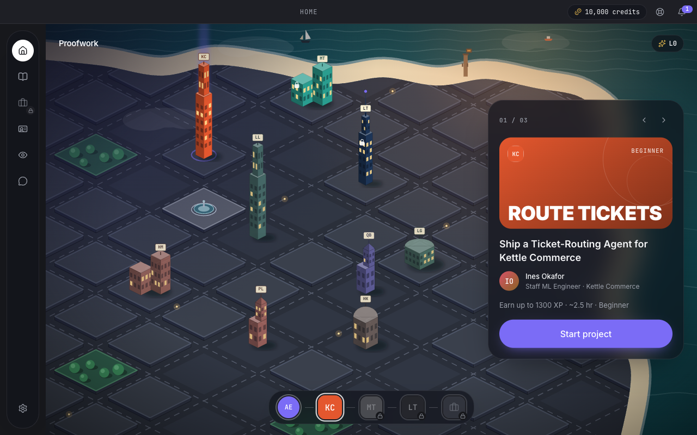

# Proofwork

Proofwork is a desktop app where you learn a job by doing it. You tell it the job you want, any job, and it writes you a personal path: three realistic projects at fictional companies, each with an AI manager who briefs you, checks your understanding, plans with you, works beside you on your screen and grades what you ship.

A nurse gets pediatric triage audits at a children's hospital. A data journalist gets a city budget investigation. A wildlife biologist gets a salmon mortality study on the Fraser River. Every company, manager, kickoff meeting, lesson, rubric and job posting is generated for that learner from their onboarding answers.

It is a **clean-room rebuild** of a commercial AI job-simulation desktop app, re-implemented from our own behavioural notes on how that app works. It keeps the same essence and changes the look. No code, art, copy, fonts or brand from the original app were used, and every company in it is fictional.



## What you can do in it

| Step | What happens | Screens |
|---|---|---|
| Sign in | Local email sign-in, or browser sign-in that returns through a `proofwork://` deep link | `01` |
| Onboarding | Server-driven steps: draw your dream job → chat (role, level, industry, company type, location, timeline fill a vision board) → why and background → match → roadmap → claim 10,000 credits | `02–05` |
| Personal path | The match step offers a path **built for you** (plus any authored career that fits). Building it writes 3 companies, 3 managers, 3 projects (kickoff, Proof of Understanding questions, 4 stages with lessons and quizzes) and 5 job postings in about 40 seconds. You can build another path later from Settings → Career (60 credits) | `26–31` |
| World map | A stylised isometric coastal district with one building per company, a project card carousel and a timeline dock ending in the job portal | `06`, `24` |
| Brief | Problem, role, tools, stages with time estimates, deliverables, and your AI manager | `07` |
| Kickoff meeting | Narrated slides with captions and speed control. After each part you write a Problem, Outcome or Process note; an AI note checker grades it, and accepted notes earn **held XP**. You can also ask the manager questions. | `08–10` |
| Proof of understanding | The manager asks questions as voice notes. You hold Space to answer, or type, and follow-ups come when your answer is partial. Passing releases the held XP. | `11` |
| Stages | **Plan** (agree scope and an estimate with the manager), **Do** (work in your own tools with the AI co-worker), **Learn** (micro-lessons, quiz, tutor) | `12–15` |
| Evaluation | Four-axis rubric (Understanding, Quality, Communication, Independence), each rated Below, Meeting or Exceeding with a one-line rationale, plus XP | `16` |
| Presentation | Camera with a lighting and framing check, slide outline, recording to disk, live on-device transcript, then graded feedback | `17–18` |
| Progress | XP and levels (L1 at 750 … L10 at 33,000), streaks, portfolio, and a job portal with a human-in-the-loop application drafter | `21–23` |
| Desktop layer | Transparent, always-on-top, capture-protected overlays: the co-worker **island**, a **highlight** layer that points at your screen, a **PiP** companion, an "I'm lost" region picker, a HUD, a record bar and a camera bubble | `14`, `25` |
| Account | 13-tab settings, credits popover and usage, plans (simulated), notifications, bug reporter (⌘⇧B), support chat, career coach | `19–20` |

All screenshots are in [`docs/screenshots`](docs/screenshots). They were taken from the running app during QA.

## Quick start

Requirements: macOS, Node 22.13+ (for `node:sqlite`) and npm. Xcode Command Line Tools are only needed for the speech helper.

```bash
npm install
```

```bash
npm run stt:build
```

```bash
npm run dev
```

`npm run dev` starts three processes:

- **server**: the API and websockets on `127.0.0.1:8787`, with data in `apps/server/data/`.
- **web**: Vite on `127.0.0.1:5173`.
- **desktop**: Electron, once both are up.

Sign in with any email; there is no password in this build.

To run it in a browser without Electron, start `npm run dev:server` and `npm run dev:web`, then open http://127.0.0.1:5173. The overlays appear as in-page frames.

### AI providers and practice mode

Copy `.env.example` to `.env` (it is gitignored) and set one key:

| Provider | Key | Quality model (paths, graders, planning) | Fast model (note checker, PoU judge, co-worker, tutor, chat, job postings) |
|---|---|---|---|
| **Gemini** (default when its key is set) | `GEMINI_API_KEY` | `PW_GEMINI_MODEL_QUALITY`, default `gemini-3.8-flash` | `PW_GEMINI_MODEL_FAST`, default `gemini-3.5-flash-lite` |
| Claude | `ANTHROPIC_API_KEY` | `PW_MODEL_QUALITY`, default `claude-opus-5-5` | `PW_MODEL_FAST`, default `claude-haiku-5-5` |

`PW_AI_PROVIDER=gemini|anthropic|practice` overrides the auto-detection. `GET /api/health` reports the active provider and models. The Gemini key is sent only in the `x-goog-api-key` header and is scrubbed from every error message.

Without a key the server runs in **practice mode**. A deterministic engine grades notes, answers, plans, submissions and presentations against the rubric points, and a template generator writes personal paths offline from 13 role families and 12 industry packs. The whole loop works without a network. Any live API error falls back to practice for that call.

Graders use structured JSON output. The co-worker streams text and uses one-shot tools (`set_todos`, `highlight`, `share_resource`, `award_xp`) with screenshots as vision input.

### How a personal path is generated

1. **Outline** (quality model, low thinking): the career, 3 fictional companies, 3 managers and 3 project outlines with key facts and stage titles, tailored to the learner's role, level, industry, company type, location, timeline, why and background.
2. **Details** (9 calls in parallel): for each project, the kickoff and Proof of Understanding, stages 1–2 and stages 3–4. A failed part is retried once and parts that succeeded are kept. **Job postings** come from one fast call that runs alongside.
3. **Assembly and validation** in code: every id is namespaced to the learner (`g-<hash>-<n>`), XP, map positions and time estimates are computed, and `validateCareerPack` from `packages/content` checks the result. If anything still fails, the learner gets the practice path instead, so the two engines are never mixed.

Paths are stored per learner in the `generated_paths` table and merged with the authored library on every request (`contentFor`), so one learner never sees another's path. Exporting or deleting your account includes them.

## Architecture

```
packages/shared    Contracts: domain types, REST route map (ApiRoutes), websocket protocols, desktop bridge (PwBridge + IPC channels), constants
packages/content   Authored content: 3 careers × 3 projects (kickoffs, PoU questions, 4 stages each), 18 trainings, 15 jobs, and the
                   validator every generated path must pass
apps/server        Fastify 5 + node:sqlite + jose. src/core = REST, DB, XP, credits, per-learner content (user-content.ts, services/paths.ts);
                   src/ai = Gemini/Claude clients (providers/), live engine and path generator (live/), practice engine and
                   template path generator (mock/pathgen/), /ws/cowork
apps/desktop       Electron 45 shell: frameless window + 44px titlebar (shell.html) + WebContentsView, overlay factory, prod server,
                   deep links, safeStorage session, offline cache (node:sqlite), STT bridge, screen capture + diff, notifications socket,
                   global shortcuts, local-video:// recordings, OTA check, smoke test
apps/renderer      React 19 + Tailwind v4 + zustand + motion. One index.html; ?surface= picks main app or an overlay
native/stt-helper  Swift STTStreamHelper.app: SFSpeechRecognizer, stdin commands, 16 kHz Float32 PCM on fd 3, PARTIAL/FINAL lines
```

Key design points:

- **One renderer, many windows.** Every overlay window loads the same bundle with `?surface=pip|hud|island|cowork|recordbar|camera|region`. Overlays are transparent, `type: "panel"`, always on top, click-through where needed, and use `setContentProtection(true)` so they never appear in screenshots the AI takes. They talk through `pw.overlay.broadcast`; the channel names are in `apps/renderer/src/lib/overlayChannels.ts`.
- **Reliable sockets.** The co-worker and notification sockets authenticate in their first frame and give every frame an `event_key`. They keep a localStorage outbox that replays on reconnect (max 3 tries), with ping/pong, stale detection and back-off. The server de-duplicates by `event_key`.
- **Personal content.** Every learner-facing lookup (careers, scenarios, objectives, stages, cowork, jobs, portfolio) goes through `contentFor(core, userId)`: the authored library plus that learner's generated paths, cached per learner.
- **Server-driven state.** Onboarding is a step machine on the server (a 409 returns the authoritative view). Objectives hold the whole run: notes, verdicts, PoU turns, stage progress and evaluations. XP from kickoff notes is held until the Proof of Understanding is passed.
- **Credits.** Every AI action debits a ledger by category: evaluation, training, AI manager, coaching or other. Plans and top-ups are simulated.

## Testing

| Command | What it covers |
|---|---|
| `npm run typecheck` | All 5 packages (TypeScript 7) |
| `npm test` | 360 tests: content validator (3); server (106: core and the full learning loop against SQLite, personal paths, websocket protocols, the Gemini client against a fake API, the live path generator with a scripted model, and the practice generator across 16 roles); renderer (251) |
| `PW_LIVE_TESTS=1 npx tsx --test apps/server/test/ai-live.test.ts` | Opt-in smoke test against the real Gemini API: one structured call and one full personal path (about 40 seconds) |
| `npm run e2e:api` | Walks a new learner through the entire loop against a running server (practice mode). `PW_E2E_PATH=custom` uses a generated path instead of an authored one |
| `npm run smoke` | Boots Electron with hidden windows and checks the bridge in all 9 windows, the cache, encrypted session storage, capture permission, STT helper status and the renderer server |
| `bash native/stt-helper/test.sh` | The speech helper protocol in fake mode (`PW_STT_FAKE=1`) |
| `scripts/qa/harness.cjs` + `scripts/qa/q` | An invisible offscreen browser (Electron) for scripted UI QA and 1280×800 screenshots |
| `scripts/qa/cdp` | Drives a desktop build started with `--remote-debugging-port=9333` |

## Packaging

```bash
npm run dist
```

This builds the renderer and runs `electron-builder --mac --dir` (`apps/desktop/electron-builder.yml`). The app bundles the renderer (served from `127.0.0.1:31470`) and the speech helper, registers `proofwork://`, enables the hardened runtime and declares the camera, microphone, speech and screen usage strings. Code signing and notarisation need your Apple Developer identity.

## What is simulated or left out

- **Payments**: plan changes and top-ups only change the local ledger.
- **Speech**: on-device recognition needs you to grant Speech Recognition permission (macOS asks on first use); until then the app offers typed answers. Text-to-speech uses the system voices.
- **Camera recording**: needs camera and microphone permission. Framing is a lighting and centre check, not face detection.
- **Not included**: cloud voice (LiveKit, Deepgram, ElevenLabs), real job boards and browser automation. The assist-apply flow drafts answers for you to review and never submits anything.
- **Practice mode**: grading is keyword- and evidence-based, and offline paths come from templates. It is good for demos and offline use, but not a substitute for the live model.
- **Generated content**: companies, people and job postings are invented by the model and checked for structure, not for facts. Treat technical details in a generated lesson as a starting point.

## How it was built

A supervising agent wrote the contracts in `packages/shared` and the server's `contracts.ts`, then split the work across 18 Claude Haiku agents, each owning one folder:

- **Content (4)**: three careers, plus trainings and jobs.
- **Backend (2)**: server core, and the AI engine with the co-worker socket.
- **Desktop and native (2)**: the Electron shell and the Swift speech helper.
- **Renderer (10)**: foundation and UI kit, onboarding, home map, brief/kickoff/PoU, stage workspace, presentation, account panels, career pages, overlays, and a map polish pass.

The supervisor reviewed every hand-off, typechecked, tested and ran the app end to end. It fixed integration bugs in shared code: CORS for PATCH and DELETE, nested theme tokens, overlay sessions, drawing coordinates, kickoff resume, checklist duplication and grader wording.

Personal paths were a second round with four agents: server core (per-learner content and the paths service), the AI engine (provider-neutral client, Gemini, the live generator), the practice generator, and the renderer (new onboarding order, the build screen, Settings → Career). The supervisor then cut live generation from 158 to about 40 seconds (low thinking, smaller parallel calls) and fixed wording, estimates and "Not sure yet" answers found in QA with nurse, marketing, teacher, electrician, journalist and biologist learners.
